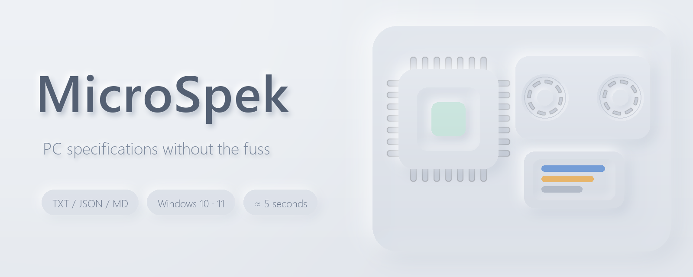
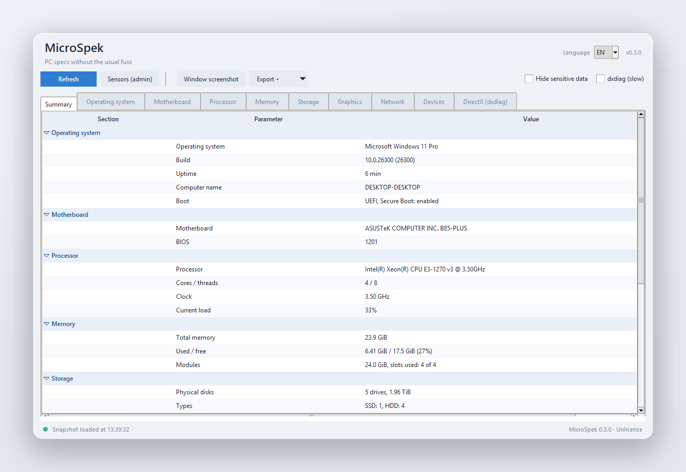

<div align="center">
  
</div>

<h1 align="center">MicroSpek</h1>

<p align="center">
  PC hardware, live sensors and an AI-ready snapshot — in one window.<br>
  Windows 10/11 · no Python required · a full report in about 5 seconds
</p>

<p align="center">
  <b>English</b> · <a href="README.ru.md">Русский</a> · <a href="https://dmitibrr.github.io/MicroSpek/">Сайт проекта</a>
</p>

<p align="center">
  <a href="https://github.com/dmitibrr/MicroSpek/releases/latest">
    
  </a>
  
  
  
</p>

---

**MicroSpek** takes a fast inventory of what is inside a computer: CPU, memory
with XMP profiles, disks with partitions and SMART, GPU, monitors, network,
audio, Bluetooth, UEFI/Secure Boot/TPM, and hardware sensors. Look at it in a
window, save it as TXT, JSON or Markdown, or hand one file to another person or
an AI — no screenshots, no retyping numbers.

It runs as a standalone `.exe` (Python is bundled) and as a console tool for
scripts.

## Features

<table>
  <tr>
    <td align="center" width="25%" valign="top">
      <br><br>
      <b>Live sensors</b><br>
      <sub>GPU temperature and hot spot, fans, voltage, power, disk SMART
      temperatures and remaining life</sub>
    </td>
    <td align="center" width="25%" valign="top">
      <br><br>
      <b>Disk layout</b><br>
      <sub>Physical disks, partitions, volumes and used space as a colour bar
      with a legend, not a wall of numbers</sub>
    </td>
    <td align="center" width="25%" valign="top">
      <br><br>
      <b>Fast</b><br>
      <sub>Collectors run in parallel: a full snapshot takes ~4.5 s from source
      and ~5.7 s in the packaged exe</sub>
    </td>
    <td align="center" width="25%" valign="top">
      <br><br>
      <b>Nothing extra</b><br>
      <sub><code>--redact</code> hides serial numbers, MAC addresses and the
      user name before a report leaves the machine</sub>
    </td>
  </tr>
</table>

## What it looks like

<div align="center">
  
</div>

The **Summary** tab puts everything important on one screen. The other tabs
(**OS**, **Motherboard**, **Processor**, **Memory**, **Storage**, **Graphics**,
**Network**, **Devices**) show the details: models, clocks, firmware, slots,
partitions.

Toolbar:

| Control | What it does |
| --- | --- |
| **Refresh** (`Ctrl+R`) | collects again in a background thread; the window stays responsive |
| **Sensors (admin)** | one UAC prompt: CPU temperatures, fans, disk SMART |
| **Window screenshot** | saves the current window as PNG |
| **Export ▾** | one menu for TXT, JSON and Markdown |
| **Hide sensitive data** | serials, MAC, user → `hidden` |
| **dxdiag (slow)** | optional DirectX report, up to a minute |
| **RU / EN** | switches the interface and exported reports instantly |

## Four editions

Every archive is standalone: unpack it and run the `.exe`. Python is not needed.

| Edition | Contents | Archive | Best for |
| --- | --- | --- | --- |
| **full** | `MicroSpek-GUI.exe`, `microspek.exe`, sensor helper, `SNAPSHOT.cmd` | ~30 MB | normal desktop use and scripts |
| **gui** | `MicroSpek.exe` only | ~21 MB | a clean window without console tools |
| **cli** | `microspek.exe` + `SNAPSHOT.cmd` | ~11 MB | scripts, CI, AI agents |
| **snapshot** | `microspek-snapshot.exe` + `microspek.json` | ~11 MB | embedding into another app |

The **snapshot** edition is the config-first build: it links no GUI libraries at
all, reads `microspek.json` next to the exe, collects only the sections you list
and writes the report without asking anything. With
`os,cpu,memory,storage,gpu` and sensors off it finishes in about 3 seconds.

The **gui** edition is the full redesign — quiet light palette, zebra tables,
localized tabs, export menu and status indicator — without the console binary.

## Download and run

1. Open the [latest release](https://github.com/dmitibrr/MicroSpek/releases/latest)
   and download the archive you need, for example
   `MicroSpek-0.3.0-full-WIN64.zip`.
2. Unpack the **whole** archive into any folder (for example Documents).
   Do not remove the `sensors` folder: it contains the sensor helper.
3. Run `MicroSpek-GUI.exe` (full) or `MicroSpek.exe` (gui). No Python and no
   administrator rights are required.

The easiest way to send a report: double-click `SNAPSHOT.cmd`. It creates
`snapshot_SAFE.txt` without serial numbers and MAC addresses and opens it in
Notepad. Windows will ask for administrator rights: **Yes** adds disk SMART
temperatures, **No** collects everything else.

> [!NOTE]
> The archives are not code-signed, so SmartScreen may show “Unknown publisher”.
> Choose **More info → Run anyway**.

## Command line

```powershell
microspek.exe --summary                        # short summary to the console
microspek.exe --snapshot                       # full TXT snapshot to stdout
microspek.exe --output txt --file pc.txt
microspek.exe --output json --file pc.json
microspek.exe --output md  --file pc.md        # Notion / Obsidian / AI chats
microspek.exe --redact --output md --file safe.md
microspek.exe --lang en --output md --file pc-en.md
microspek.exe --admin-sensors --output txt --file full.txt
microspek.exe --no-dxdiag --summary            # skip the slow DirectX report
microspek.exe --sections cpu,memory,storage --no-sensors   # fast partial report
```

| Flag | Purpose |
| --- | --- |
| `--summary` / `--snapshot` | print a short summary or the full report |
| `--output {txt,json,md}` | save the report to a file |
| `--file PATH` | target path (a dated name is used by default) |
| `--redact` | hide serial numbers, MAC addresses, user name |
| `--lang {ru,en}` | interface and report language |
| `--sections LIST` | collect only these sections |
| `--no-sensors` | skip the sensor helper (faster, no temperatures/SMART) |
| `--admin-sensors` | one UAC prompt for CPU temperatures and disk SMART |
| `--no-dxdiag` / `--dxdiag-timeout SEC` | disable dxdiag or change its timeout |
| `--config PATH` | read defaults from `microspek.json` |
| `--gui` | open the window |

## Snapshot edition and `microspek.json`

The snapshot edition is meant to be embedded into other tools. Put
`microspek.json` next to `microspek-snapshot.exe`:

```json
{
  "output": "md",
  "file": "reports/pc.md",
  "redact": true,
  "sections": ["os", "cpu", "memory", "storage", "gpu"],
  "sensors": true,
  "dxdiag": false,
  "admin_sensors": false,
  "lang": "en",
  "open": false,
  "quiet": false
}
```

- `sections` — list or comma string; `all`, `*` or an empty value means every
  section. Available keys: `os`, `motherboard`, `cpu`, `memory`, `storage`,
  `gpu`, `network`, `devices`, `dxdiag`.
- `file` — relative paths are resolved next to the configuration file.
- `open` — open the finished report in the default application.
- Flags override the file, so the same exe can be reused with
  `--sections cpu --stdout` in a pipeline.

## Output formats

| Format | What it is for |
| --- | --- |
| **TXT** | the classic aligned snapshot: easy to read and to paste into a chat |
| **JSON** | `microspek.snapshot/1` with `language`, sections, items and layouts |
| **Markdown** | headings and tables that render in GitHub, Notion, Obsidian and AI chats |

Markdown excerpt:

```markdown
## Processor

### General

| Parameter | Value | Note |
| --- | --- | --- |
| Model | Intel(R) Xeon(R) CPU E3-1270 v3 @ 3.50GHz |  |
| Cores / threads | 4 / 8 |  |
```

## What is collected

| Section | Data |
| --- | --- |
| **OS** | version and build, uptime, UEFI/Legacy, Secure Boot, TPM |
| **Motherboard** | vendor, model, BIOS and date, chassis, battery |
| **Processor** | model, cores/threads, clocks, L1–L3 cache, socket, virtualization |
| **Memory** | total, modules, vendor, SPD and running speed, XMP/JEDEC profile |
| **Storage** | model, serial, firmware, type and bus, SMART, partitions, volumes, used space |
| **Graphics** | controllers, driver, VRAM, monitors (EDID), connection type |
| **Network** | adapters, link speed, MAC, IP addresses |
| **Devices** | audio, Bluetooth, PnP problems, SATA mode |

Hardware sensors come from **LibreHardwareMonitorLib 0.9.6**: GPU temperature,
hot spot and memory temperature, fan RPM and percentage, voltage and power, CPU
temperatures, Super I/O sensors and disk SMART fields.

## Sensors and administrator rights

`MicroSpekSensors.exe` (a small C# helper shipped next to the program) starts
without elevation and immediately returns what a regular user can read.
Disk SMART data and CPU temperatures need administrator rights:
`--admin-sensors` and `SNAPSHOT.cmd` ask for UAC **once**; if you decline, the
snapshot continues without those fields.

CPU temperatures and fan speeds on many boards also need the **PawnIO** driver
(LHM 0.9.6 uses it instead of WinRing0). It is not bundled and is not installed
automatically: without it disk SMART and GPU sensors still work, while CPU/fan
fields stay `—`.

## Build from source

```powershell
python -m pip install -r requirements.txt
python scripts/fetch_sensors_vendor.py   # once: LibreHardwareMonitorLib + dependencies
python scripts/build_sensors.py          # compile MicroSpekSensors.exe
python scripts/build_exe.py --edition all   # four ZIPs in dist/
```

Run without building:

```powershell
python run_microspek.py                  # GUI
python run_microspek.py --summary
python run_microspek.py --output md --file report.md
python -m unittest discover -s tests     # 33 offline tests
```

The sensor helper is compiled by `csc.exe` from .NET Framework 4.8, which ships
with Windows — no .NET SDK is needed. `scripts/make_readme_art.py` redraws all
README artwork with Pillow.

## Structure

```
src/microspek/
  __main__.py        CLI entry point
  snapshot_cli.py    entry point of the snapshot edition
  gui.py             Tkinter GUI
  i18n.py            RU/EN strings, labels and report translation
  config.py          microspek.json
  snapshot.py        parallel collection, section filter, sensors toggle
  render.py          TXT / JSON / Markdown export
  models.py          data models and redaction
  util.py            PowerShell, formatting, dates
  collectors/        cpu, memory, motherboard, storage, gpu, network,
                     os_info, devices, dxdiag, sensors
tools/sensors/       MicroSpekSensors.cs — C# helper for LibreHardwareMonitorLib
scripts/             exe/sensor/release/artwork builds
docs/images/         README graphics
run_microspek.py     launch from the project root
```

## Requirements

- Windows 10/11 (x64), PowerShell 5.1.
- Nothing for a ready-made `.exe`.
- Python 3.10+ to run from source; Pillow only for the window screenshot and
  the README artwork.
- .NET Framework 4.8 (built into Windows) and the NuGet packages downloaded by
  `scripts/fetch_sensors_vendor.py` to build the sensor helper.

## Privacy

MicroSpek works completely offline. It has no telemetry, no accounts and no
network calls of its own: the only network values in the report are the
adapters and addresses that Windows already knows. Use `--redact` (or the
checkbox in the GUI) before sharing a report.

## Third-party licences

`MicroSpekSensors.exe` uses LibreHardwareMonitorLib 0.9.6 and its dependencies
(DiskInfoToolkit, RAMSPDToolkit-NDD, BlackSharp.Core — MPL-2.0; HidSharp —
Apache-2.0; `System.*` packages — MIT). Notices and full licence texts travel in
the `sensors/` folder: `THIRD_PARTY.md`, `LICENSE-MPL-2.0.txt`,
`LICENSE-HidSharp.txt`. MicroSpek itself is released under the **Unlicense**
(public domain): use, modify and redistribute it without attribution.

## Known details

- Used space is shown for volumes that lie entirely on one partition; for an
  LDM volume spanning two disks (for example `L:`) the number is hidden to
  avoid double counting.
- WMI `AdapterRAM` is often capped at 4 GB; the exact VRAM size comes from
  nvidia-smi when it is installed.
- Without administrator rights SMART fields and CPU temperatures are empty;
  without the PawnIO driver only CPU temperatures and fans are missing.
- dxdiag is disabled by default in the GUI: it can take up to a minute.

---

<div align="center">
  <sub>MicroSpek · Unlicense · built for quick diagnostics without installing anything extra</sub>
</div>
