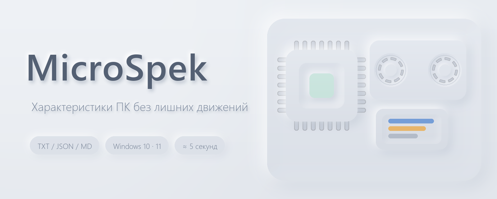
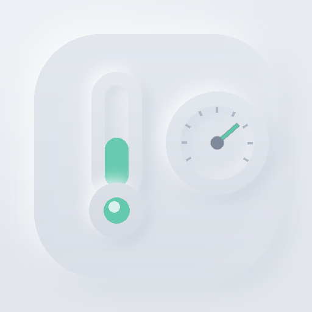
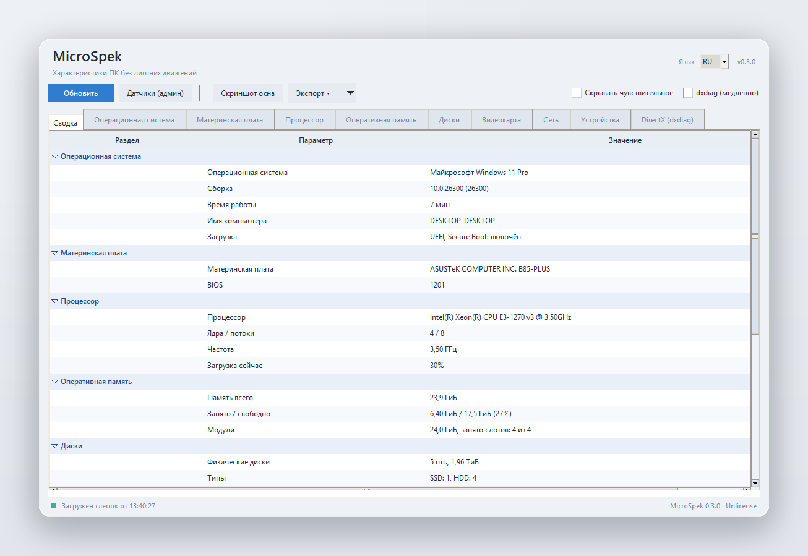

<div align="center">
  
</div>

<h1 align="center">MicroSpek</h1>

<p align="center">
  Характеристики ПК, живые датчики и слепок для ИИ — в одном окне.<br>
  Windows 10/11 · Python не нужен · полный отчёт примерно за 5 секунд
</p>

<p align="center">
  <a href="README.md">English</a> · <b>Русский</b> · <a href="https://dmitibrr.github.io/MicroSpek/">Сайт проекта</a>
</p>

<p align="center">
  <a href="https://github.com/dmitibrr/MicroSpek/releases/latest">
    
  </a>
  
  
  
</p>

---

**MicroSpek** — это быстрый снимок того, что стоит в компьютере: процессор,
память с профилем XMP, диски с разметкой и SMART, видеокарта, мониторы, сеть,
звук, Bluetooth, UEFI/Secure Boot/TPM и аппаратные датчики. Всё это можно
посмотреть в окне, сохранить в TXT, JSON или Markdown либо отдать одним файлом
другому человеку или ИИ — без скриншотов и переписывания цифр руками.

Работает как самостоятельная программа для Windows (`.exe`, Python внутри)
и как консольная утилита для скриптов.

## Возможности

<table>
  <tr>
    <td align="center" width="25%" valign="top">
      <br><br>
      <b>Живые датчики</b><br>
      <sub>Температуры GPU и hot spot, вентиляторы, напряжение, мощность,
      SMART-температуры и остаток ресурса дисков</sub>
    </td>
    <td align="center" width="25%" valign="top">
      <br><br>
      <b>Разметка дисков</b><br>
      <sub>Физические диски, разделы, тома и занятое место — цветной полосой
      с легендой, а не таблицей цифр</sub>
    </td>
    <td align="center" width="25%" valign="top">
      <br><br>
      <b>Быстро</b><br>
      <sub>Коллекторы работают параллельно: полный слепок ~4,5 с из исходников
      и ~5,7 с в собранном exe</sub>
    </td>
    <td align="center" width="25%" valign="top">
      <br><br>
      <b>Без лишнего</b><br>
      <sub>Флаг <code>--redact</code> прячет серийники, MAC и имя пользователя
      перед отправкой отчёта</sub>
    </td>
  </tr>
</table>

## Как это выглядит

<div align="center">
  
</div>

Вкладка **Сводка** — всё главное одним экраном. Остальные вкладки
(**ОС**, **Материнская плата**, **Процессор**, **Оперативная память**, **Диски**,
**Видеокарта**, **Сеть**, **Устройства**) показывают детали: модели, частоты,
прошивки, слоты, разделы.

Кнопки в окне:

| Кнопка | Что делает |
| --- | --- |
| **Обновить** (`Ctrl+R`) | повторный сбор в фоновом потоке, окно не подвисает |
| **Датчики (админ)** | один запрос UAC: температуры CPU, вентиляторы, SMART дисков |
| **Скриншот окна** | сохраняет текущее окно в PNG |
| **Экспорт ▾** | одно меню для TXT, JSON и Markdown |
| **Скрывать чувствительное** | серийники, MAC, пользователь → «скрыто» |
| **dxdiag (медленно)** | дополнительный отчёт DirectX, до минуты |
| **RU / EN** | мгновенно переключает интерфейс и язык отчётов |

## Четыре издания

Каждый архив самостоятельный: распакуйте и запустите `.exe`. Python не нужен.

| Издание | Что внутри | Архив | Для чего |
| --- | --- | --- | --- |
| **full** | `MicroSpek-GUI.exe`, `microspek.exe`, сборщик датчиков, `SNAPSHOT.cmd` | ~30 МБ | обычная работа в окне и скрипты |
| **gui** | только `MicroSpek.exe` | ~21 МБ | чистое окно без консольных утилит |
| **cli** | `microspek.exe` + `SNAPSHOT.cmd` | ~11 МБ | скрипты, CI, ИИ-агенты |
| **snapshot** | `microspek-snapshot.exe` + `microspek.json` | ~11 МБ | встраивание в другое приложение |

**snapshot** — самое лёгкое по устройству издание: в нём вообще нет
GUI-библиотек, настройки читаются из `microspek.json` рядом с exe, собираются
только перечисленные разделы, и отчёт пишется без единого вопроса. С набором
`os,cpu,memory,storage,gpu` и выключенными датчиками сбор занимает около
3 секунд.

**gui** — это полный редизайн: спокойная светлая палитра, полосатые таблицы,
локализованные вкладки, меню экспорта и индикатор состояния — без консольного
бинарника.

## Скачать и запустить

1. Откройте [последний релиз](https://github.com/dmitibrr/MicroSpek/releases/latest)
   и скачайте нужный архив, например `MicroSpek-0.3.0-full-WIN64.zip`.
2. Распакуйте архив **целиком** в любую папку (например, в «Документы»).
   Папку `sensors` удалять нельзя — в ней сборщик датчиков.
3. Запустите `MicroSpek-GUI.exe` (full) или `MicroSpek.exe` (gui). Python и
   права администратора не нужны.

Самый простой способ прислать отчёт: двойной клик по `SNAPSHOT.cmd` —
рядом появится `snapshot_SAFE.txt` без серийников и MAC, он сразу откроется
в Блокноте. Windows спросит разрешение администратора: «Да» добавит
SMART-температуры дисков, «Нет» — соберёт всё остальное.

> [!NOTE]
> Архивы не подписаны сертификатом, поэтому SmartScreen может показать
> «Неизвестный издатель» → «Подробнее» → «Выполнить в любом случае».

## Командная строка

```powershell
microspek.exe --summary                        # короткая сводка в консоль
microspek.exe --snapshot                       # полный TXT-слепок в консоль
microspek.exe --output txt --file pc.txt
microspek.exe --output json --file pc.json
microspek.exe --output md  --file pc.md        # Notion / Obsidian / чаты с ИИ
microspek.exe --redact --output md --file safe.md
microspek.exe --lang en --output md --file pc-en.md
microspek.exe --admin-sensors --output txt --file full.txt
microspek.exe --no-dxdiag --summary            # без медленного DirectX
microspek.exe --sections cpu,memory,storage --no-sensors   # быстрый частичный отчёт
```

| Флаг | Назначение |
| --- | --- |
| `--summary` / `--snapshot` | печать сводки или полного отчёта |
| `--output {txt,json,md}` | сохранить отчёт в файл |
| `--file PATH` | путь к файлу (по умолчанию имя с датой) |
| `--redact` | скрыть серийные номера, MAC, пользователя |
| `--lang {ru,en}` | язык интерфейса и отчёта |
| `--sections LIST` | собирать только указанные разделы |
| `--no-sensors` | не запускать сборщик датчиков (быстрее, без температур и SMART) |
| `--admin-sensors` | один запрос UAC для температур CPU и SMART дисков |
| `--no-dxdiag` / `--dxdiag-timeout SEC` | отключить dxdiag или изменить таймаут |
| `--config PATH` | прочитать настройки из `microspek.json` |
| `--gui` | открыть окно |

## Издание snapshot и `microspek.json`

Издание snapshot предназначено для встраивания в другие инструменты.
Положите `microspek.json` рядом с `microspek-snapshot.exe`:

```json
{
  "output": "md",
  "file": "reports/pc.md",
  "redact": true,
  "sections": ["os", "cpu", "memory", "storage", "gpu"],
  "sensors": true,
  "dxdiag": false,
  "admin_sensors": false,
  "lang": "ru",
  "open": false,
  "quiet": false
}
```

- `sections` — список или строка через запятую; `all`, `*` или пустое значение
  означает все разделы. Доступные ключи: `os`, `motherboard`, `cpu`, `memory`,
  `storage`, `gpu`, `network`, `devices`, `dxdiag`.
- `file` — относительные пути считаются от папки с конфигурацией.
- `open` — открыть готовый отчёт приложением по умолчанию.
- Флаги командной строки важнее файла, поэтому один и тот же exe можно
  использовать в конвейере с `--sections cpu --stdout`.

## Форматы отчётов

| Формат | Для чего |
| --- | --- |
| **TXT** | классический выровненный слепок: удобно читать и вставлять в чат |
| **JSON** | `microspek.snapshot/1` с `language`, разделами, параметрами и разметкой |
| **Markdown** | заголовки и таблицы, которые рендерятся в GitHub, Notion, Obsidian и чатах с ИИ |

Фрагмент Markdown:

```markdown
## Процессор

### Основное

| Параметр | Значение | Примечание |
| --- | --- | --- |
| Модель | Intel(R) Xeon(R) CPU E3-1270 v3 @ 3.50GHz |  |
| Ядра / потоки | 4 / 8 |  |
```

## Что собирается

| Раздел | Данные |
| --- | --- |
| **ОС** | версия и сборка, время работы, UEFI/Legacy, Secure Boot, TPM |
| **Плата** | производитель, модель, BIOS и дата, корпус, батарея |
| **Процессор** | модель, ядра/потоки, частоты, кэш L1–L3, сокет, виртуализация |
| **Память** | объём, модули, производитель, SPD и рабочая частота, профиль XMP/JEDEC |
| **Диски** | модель, серийник, прошивка, тип и шина, SMART, разделы, тома, занятое место |
| **Видеокарта** | контроллеры, драйвер, видеопамять, мониторы (EDID), тип подключения |
| **Сеть** | адаптеры, скорость, MAC, IP-адреса |
| **Устройства** | звук, Bluetooth, проблемные PnP, режим SATA |

Аппаратные датчики читаются через **LibreHardwareMonitorLib 0.9.6**:
температуры GPU, hot spot и память, обороты вентилятора и его процент,
напряжение и мощность, температуры CPU, датчики Super I/O, SMART-поля дисков.

## Датчики и права администратора

`MicroSpekSensors.exe` (отдельный маленький C#-хелпер рядом с программой)
запускается без прав и сразу отдаёт то, что доступно обычному пользователю.
SMART-данные дисков и температуры CPU требуют администратора: `--admin-sensors`
и `SNAPSHOT.cmd` запрашивают UAC **один раз**, при отказе сбор продолжается
без этих полей.

Температуры CPU и обороты вентиляторов на многих платах требуют драйвера
**PawnIO** (LHM 0.9.6 использует его вместо WinRing0). Он не входит в архив
и не устанавливается автоматически: без него SMART дисков и датчики
видеокарты всё равно работают, а поля CPU/вентиляторов остаются «—».

## Сборка из исходников

```powershell
python -m pip install -r requirements.txt
python scripts/fetch_sensors_vendor.py   # один раз: LibreHardwareMonitorLib + зависимости
python scripts/build_sensors.py          # компиляция MicroSpekSensors.exe
python scripts/build_exe.py --edition all   # четыре ZIP в dist/
```

Запуск без сборки:

```powershell
python run_microspek.py                  # GUI
python run_microspek.py --summary
python run_microspek.py --output md --file report.md
python -m unittest discover -s tests     # 33 офлайн-теста
```

Хелпер датчиков компилируется `csc.exe` из состава .NET Framework 4.8,
который уже есть в Windows — .NET SDK не нужен. `scripts/make_readme_art.py`
перерисовывает все картинки для README с нуля (Pillow).

## Структура

```
src/microspek/
  __main__.py        точка входа CLI
  snapshot_cli.py    точка входа издания snapshot
  gui.py             Tkinter GUI
  i18n.py            строки RU/EN, перевод отчётов
  config.py          microspek.json
  snapshot.py        параллельный сбор, фильтр разделов, датчики
  render.py          экспорт TXT / JSON / Markdown
  models.py          модели данных и редакт
  util.py            PowerShell, форматирование, даты
  collectors/        cpu, memory, motherboard, storage, gpu, network,
                     os_info, devices, dxdiag, sensors
tools/sensors/       MicroSpekSensors.cs — C#-хелпер для LibreHardwareMonitorLib
scripts/             сборка exe, датчиков, релиза, картинок
docs/images/         графика для README
run_microspek.py     запуск из корня проекта
```

## Требования

- Windows 10/11 (x64), PowerShell 5.1.
- Для готового `.exe` — ничего.
- Для запуска из исходников — Python 3.10+; Pillow нужен только для скриншота
  окна и картинок README.
- Для сборки датчиков — .NET Framework 4.8 (встроен в Windows) и пакеты NuGet,
  которые скачивает `scripts/fetch_sensors_vendor.py`.

## Приватность

MicroSpek работает полностью офлайн. В нём нет телеметрии, учётных записей и
собственных сетевых запросов: сетевые значения в отчёте — это только адаптеры
и адреса, которые уже знает Windows. Перед отправкой отчёта включите
`--redact` (или галочку в окне).

## Лицензии сторонних компонентов

`MicroSpekSensors.exe` использует LibreHardwareMonitorLib 0.9.6 и её зависимости
(DiskInfoToolkit, RAMSPDToolkit-NDD, BlackSharp.Core — MPL-2.0; HidSharp —
Apache-2.0; пакеты `System.*` — MIT). Уведомления и полные тексты лицензий
лежат в папке `sensors/` рядом с программой: `THIRD_PARTY.md`,
`LICENSE-MPL-2.0.txt`, `LICENSE-HidSharp.txt`. Сам MicroSpek распространяется
по лицензии **Unlicense** (общественное достояние): используйте, меняйте и
распространяйте без указания авторства.

## Известные нюансы

- Занятое место показывается для томов, целиком лежащих на одном разделе;
  для томов из LDM-массива (например, `L:` на двух дисках) число скрыто,
  чтобы не дублировать его.
- `AdapterRAM` в WMI часто ограничен 4 ГБ — точный объём видеопамяти берётся
  из nvidia-smi, если он установлен.
- Без прав администратора SMART-поля и температуры CPU пустые; без драйвера
  PawnIO — только температуры CPU и вентиляторы.
- dxdiag в GUI выключен по умолчанию: он может занимать до минуты.

---

<div align="center">
  <sub>MicroSpek · Unlicense · сделано для быстрой диагностики без установки лишнего</sub>
</div>
